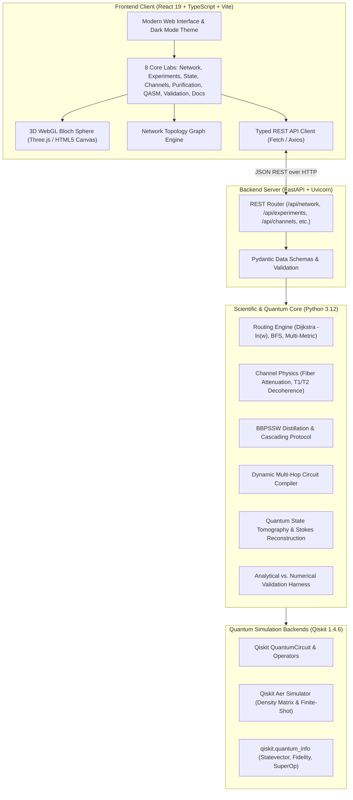

<div align="center">

  

  # QuantumRoute V2
  ### Noise-Aware Quantum Communication, Multi-Hop Entanglement Routing & State Teleportation Platform

  **VTU-Qiskit Fall Fest 2026 Hackathon** · **Team ID:** `VTU-QFF-HC-0126` · **Team:** Quantum D Clan  
  *VTU Belagavi · Track: Quantum Communication & Networking*

  [](https://www.python.org/)
  [](https://qiskit.org/)
  [](https://github.com/Qiskit/qiskit-aer)
  [](https://fastapi.tiangolo.com/)
  [](https://react.dev/)
  [](https://www.typescriptlang.org/)
  [](https://vitejs.dev/)
  [](tests/)
  [](LICENSE)

</div>

---

## 📌 Table of Contents

- [Executive Summary](#-executive-summary)
- [Team Members & Attribution](#-team-members--attribution)
- [Project Overview](#-project-overview)
  - [The Problem](#the-problem)
  - [Our Solution](#our-solution)
  - [Target Users](#target-users)
- [Interactive Platform Modules](#-interactive-platform-modules)
  - [1. Network Lab](#1-network-lab)
  - [2. Experiments](#2-experiments)
  - [3. State Analysis](#3-state-analysis)
  - [4. Channels Lab](#4-channels-lab)
  - [5. Purification Lab](#5-purification-lab)
  - [6. QASM Export](#6-qasm-export)
  - [7. Validation](#7-validation)
  - [8. Documentation](#8-documentation)
- [System Architecture](#-system-architecture)
- [Technology Stack](#️-technology-stack)
- [Installation and Setup](#-installation-and-setup)
  - [Prerequisites](#prerequisites)
  - [1. Clone Repository](#1-clone-repository)
  - [2. Backend Setup](#2-backend-setup)
  - [3. Frontend Setup](#3-frontend-setup)
- [Quick Start Guide](#-quick-start-guide)
- [Scientific Foundations](#-scientific-foundations)
  - [Werner-Link Model](#1-werner-link-model)
  - [Path Composition and Fidelity](#2-path-composition-and-fidelity)
  - [Quality-Aware Routing Formulation](#3-quality-aware-routing-formulation)
  - [Physical Attenuation and Decoherence](#4-physical-attenuation-and-decoherence)
  - [BBPSSW Entanglement Purification](#5-bbpssw-entanglement-purification)
- [Testing & Quality Assurance](#-testing--quality-assurance)
- [Limitations & Scientific Assumptions](#-limitations--scientific-assumptions)
- [Project Status](#-project-status)
- [License & Acknowledgments](#-license--acknowledgments)

---

## 🚀 Executive Summary

**QuantumRoute V2** is a full-stack, research-grade quantum network simulation platform engineered for the **VTU-Qiskit Fall Fest 2026 Hackathon**.

Traditional classical networks route packets by minimizing hop count. In quantum repeaters and entanglement distribution networks, hop count is an unreliable heuristic: passing through fewer noisy quantum channels often yields vastly inferior end-to-end state fidelity compared to a slightly longer route comprised of high-purity links.

QuantumRoute bridges theoretical quantum communication and software engineering. It couples an analytical Werner-state network graph engine with real Qiskit circuit synthesis, density-matrix numerical simulation via Qiskit Aer, physical channel loss modelling, BBPSSW entanglement purification, 3D WebGL quantum state visualization, and automated OpenQASM 3.0 export.

---

## 👥 Team Members & Attribution

**Team:** Quantum D Clan  
**Team ID:** `VTU-QFF-HC-0126`  
**Hackathon:** VTU-Qiskit Fall Fest 2026, VTU Belagavi  
**Track:** Quantum Communication & Networking

| # | Name | GitHub Username | Role | Primary Responsibilities |
|---|---|---|---|---|
| 1 | **Yuvaraj B Sutar** | [@YUVA56-gomu](https://github.com/YUVA56-gomu) | Team Lead | Scientific architecture, circuit simulation, routing mathematics |
| 2 | **Srijan Rastogi** | [@SrijanRastogi](https://github.com/SrijanRastogi) | Developer | Full-stack platform engineering, React UI, API endpoints |
| 3 | **Veeresh M A** | [@Veeresh23-06](https://github.com/Veeresh23-06) | Developer | Channel loss physics, purification protocols, test harnesses |

---

## 💡 Project Overview

### The Problem
Quantum communication relies on transmitting delicate quantum states across long distances. Because the **No-Cloning Theorem** prohibits amplifying unknown quantum states, long-distance communication requires **entanglement distribution, intermediate entanglement swapping, and quantum teleportation**.

However:
1. **Environmental Noise & Decoherence:** Optical fiber attenuation, detector dark counts, and memory dephasing rapidly degrade shared Bell pairs.
2. **Shortest-Path Fallacy:** Classical routing protocols (e.g. Breadth-First Search) select paths with the minimum number of hops. In quantum networks, a 2-hop path across degraded links ($w=0.4$) yields $w_{\text{path}} = 0.16$, whereas a 3-hop path of high-quality links ($w=0.9$) yields $w_{\text{path}} = 0.729$—a massive fidelity advantage.
3. **Abstraction Gap:** Researchers often evaluate routing algorithms purely on graphs without validating whether the corresponding dynamic multi-qubit quantum circuits can be physically synthesized and executed.

### Our Solution
QuantumRoute V2 provides an end-to-end platform that:
- **Models Noisy Quantum Links:** Formalizes links as two-qubit Werner states $\rho_W(w)$ parameterized by Werner visibility $w \in [0, 1]$.
- **Implements Quality-Aware Routing:** Computes optimal paths using Dijkstra’s algorithm on logarithmic cost weights $c_e = -\ln(w_e)$, provably maximizing multiplicative end-to-end Werner parameter $\prod w_e$.
- **Synthesizes Multi-Hop Circuits:** Dynamically generates 2N-qubit quantum circuits with Bell-state measurements, deferred-measurement corrections, and feedforward operations.
- **Simulates Physics-Based Impairments:** Evaluates telecom fiber attenuation ($0.2\text{ dB/km}$ at $1550\text{ nm}$), detector SNR scaling, and $T_1 / T_2$ memory relaxation.
- **Distills Entanglement:** Implements multi-round BBPSSW quantum purification with bilateral CNOT gates and parity post-selection.
- **Validates Predictions:** Cross-validates analytical network predictions directly against exact Qiskit Aer density-matrix simulations ($\Delta F < 10^{-14}$).

### Target Users
- **Quantum Network Researchers:** Investigating routing policies, purification yield, and repeater placement.
- **Quantum Software Engineers:** Prototyping quantum network protocols and generating verified OpenQASM 3.0 circuits.
- **Students & Educators:** Visually exploring teleportation, entanglement swapping, noise channels, and the Bloch sphere in an interactive environment.

---

## 🔬 Interactive Platform Modules

QuantumRoute V2 features eight integrated modules accessible via the unified web interface:

```text
┌────────────────────────────────────────────────────────────────────────┐
│                          QuantumRoute V2                              │
├──────────────┬─────────────────────────────────────────────────────────┤
│ Network Lab  │ Interactive graph topologies, link editor, BFS vs Dijkstra│
│ Experiments  │ Teleportation & swapping circuits, noise parameter sweep│
│ State Analysis│ 3D WebGL Bloch sphere, coordinate editor, state tomography│
│ Channels Lab │ Fiber attenuation (dB/km), detector dark counts, T1/T2   │
│ Purification │ BBPSSW 4-qubit bilateral distillation & cascading rounds│
│ QASM Export  │ OpenQASM 3.0, OpenQASM 2.0, & Qiskit Python generator   │
│ Validation   │ Analytical model vs. Qiskit Aer simulation harness      │
│ Documentation│ Mathematical formulations, scientific references, guides│
└──────────────┴─────────────────────────────────────────────────────────┘
```

### 1. Network Lab
- **Interactive Topologies:** Switch between benchmark topologies (Karnataka Quantum Backbone, Ring-5, Star-6, Mesh Grid 3x3, and Custom user graphs).
- **In-Place Link Customization:** Interactively edit edge parameters including Werner parameter $w_e$, physical fiber distance $d$ (km), attenuation coefficient $\alpha$, and link operational status.
- **Routing Comparison:** Side-by-side comparison of **Shortest-Hop Routing (BFS)** versus **Quality-Aware Routing (Dijkstra)**, highlighting divergence cases where Dijkstra selects a longer path to achieve superior fidelity.
- **Dual-Metric Optimization:** Analyze the trade-off between quantum state fidelity and classical signaling propagation delay.

### 2. Experiments
- **Single-Link Teleportation:** Execute standard 3-qubit teleportation circuits with customizable arbitrary input states $|\psi\rangle = \cos(\theta/2)|0\rangle + e^{i\phi}\sin(\theta/2)|1\rangle$.
- **Multi-Hop Entanglement Swapping:** Dynamically compile $2N$-qubit repeater chains with Bell-state measurements (BSM) and feedforward Pauli corrections.
- **Noise Sweeps:** Simulate teleportation under variable depolarizing probability $p \in [0, 1]$ and plot output fidelity against the theoretical bound $F = 1 - p/2$.

### 3. State Analysis
- **3D WebGL Bloch Sphere:** Interactive sphere rendered with Three.js / Canvas, supporting 360° orbit controls and animated state vectors.
- **Bi-Directional Coordinate Editor:** Modify states seamlessly in Cartesian coordinates $(x, y, z)$ or spherical angles $(\theta, \phi)$, with automatic normalization to the unit sphere.
- **Quantum State Tomography:** Simulates finite-shot projective measurements in Pauli bases ($X, Y, Z$), reconstructs the Stokes parameters, and applies physical density-matrix projection to ensure non-negative eigenvalues.

### 4. Channels Lab
- **Silica Fiber Model:** Calculates photon loss based on standard telecom fiber characteristics ($\alpha = 0.2\text{ dB/km}$ at $1550\text{ nm}$) using the transmittance function $\eta = 10^{-\alpha d / 10}$.
- **Detector Impairments:** Models superconducting nanowire single-photon detector (SNSPD) dark counts and signal-to-noise ratio degradation.
- **Quantum Memory Relaxation:** Simulates longitudinal energy relaxation ($T_1$) and transverse dephasing ($T_2$) on parked link qubits awaiting classical feedforward.

### 5. Purification Lab
- **BBPSSW Protocol:** Implements the 4-qubit bilateral CNOT distillation protocol across two noisy Bell pairs.
- **Parity Post-Selection:** Models classical coincidence matching where pairs are accepted only when target measurements match ($|00\rangle$ or $|11\rangle$).
- **Cascading Distillation:** Evaluates multi-round purification showing monotonic fidelity improvement towards unity for any initial state with $F > 0.5$.
- **Yield & Cost Trade-Offs:** Displays distillation success probability, resource overhead, and net Bell-pair yield per round.

### 6. QASM Export
- **Multi-Format Synthesis:** Generates standardized **OpenQASM 3.0**, legacy **OpenQASM 2.0**, and copy-pasteable **Qiskit Python** code.
- **One-Click Clipboard & Download:** Export circuits ready for IBM Quantum hardware backends or external quantum simulators.
- **Transparent Instruction Handling:** Provides clear guidance when non-unitary Kraus noise operations or projective post-selection routines cannot be exported as raw unitary QASM.

### 7. Validation
- **Closed-Loop Verification Harness:** Systematically evaluates the analytical Werner product rule ($w_{\text{path}} = \prod w_e$) against full density-matrix circuit simulation on Qiskit Aer.
- **Quantitative Accuracy:** Proves model agreement with delta errors below $\Delta F < 10^{-14}$, verifying zero mathematical discrepancies in path fidelity calculation.
- **Comprehensive Benchmark Suite:** Validates all 21 node-pair combinations across the 7-node benchmark network.

### 8. Documentation
- **Embedded Research Manual:** Accessible directly in the UI with mathematical derivations, algorithm pseudo-code, API specifications, and reproducible citations.
- **Source of Truth Reference:** Fully synchronizes with project engineering specifications (`PLAN.md`, `AGENTS.md`, and `ARCHITECTURE.md`).

---

## 🏛️ System Architecture

QuantumRoute V2 follows a clean, decoupled architecture:



---

## 🛠️ Technology Stack

| Component | Technology | Version | Description |
|---|---|---|---|
| **Language** | Python | `3.12.14` | Core backend runtime and scientific computing environment |
| **Quantum SDK** | Qiskit | `1.4.6` | Quantum circuit creation, gate synthesis, and operator mechanics |
| **Quantum Simulator** | Qiskit Aer | `0.18.0` | High-performance density-matrix and shot-based simulation |
| **Quantum Info** | `qiskit.quantum_info` | `1.4.6` | State fidelity, partial trace, DensityMatrix, and Pauli operators |
| **Backend Framework** | FastAPI | `>=0.110.0` | Asynchronous high-throughput REST API server |
| **ASGI Server** | Uvicorn | `>=0.29.0` | Production ASGI web server |
| **Data Validation** | Pydantic | `>=2.6.0` | Strict schema validation and serialization |
| **Graph Algorithms** | NetworkX | `>=3.2.0` | Network topology representation and graph algorithms |
| **Numerical Math** | NumPy | `2.5.4` | Matrix computations and vector operations |
| **Scientific Utilities**| SciPy | `1.18.1` | Optimization, log-cost calculations, and numerical stability |
| **Frontend Framework** | React | `19.0.0` | Modern component-driven UI architecture |
| **Language** | TypeScript | `5.0+` | End-to-end typed frontend logic |
| **Build Tool** | Vite | `8.3.4` | Ultra-fast frontend bundling and development server |
| **3D Rendering** | Three.js / Canvas | Latest | Interactive 3D WebGL Bloch Sphere visualization |
| **Icons** | Lucide React | `>=0.300.0` | Professional interface iconography |
| **Testing** | pytest | `9.1.1` | Complete automated unit and integration test suite |

---

## 💻 Installation and Setup

### Prerequisites
- **Python:** Version `3.12` installed.
- **Node.js:** Version `18.0+` (or `20.0+`) and `npm` installed.
- **Git:** Version `2.30+` installed.

### 1. Clone Repository

```bash
git clone https://github.com/vtu-qiskit-fall-fest-2026/vtu-hc-quantum-d-clan.git
cd vtu-hc-quantum-d-clan
```

### 2. Backend Setup

Create and activate a virtual environment, then install dependencies:

**Windows (PowerShell):**
```powershell
python -m venv .venv
.\.venv\Scripts\Activate.ps1
pip install -r requirements.txt
```

**Linux / macOS:**
```bash
python3.12 -m venv .venv
source .venv/bin/activate
pip install -r requirements.txt
```

Start the FastAPI backend server:
```bash
uvicorn backend.main:app --host 127.0.0.1 --port 8000 --reload
```
The interactive Swagger API documentation will be available at `http://127.0.0.1:8000/docs`.

### 3. Frontend Setup

In a separate terminal, navigate to the `frontend` directory and start the Vite development server:

```bash
cd frontend
npm install
npm run dev
```

Open your browser to:
```text
http://localhost:5173
```

---

## ⚡ Quick Start Guide

1. **Launch the Platform:** Follow the installation steps above to start both the backend (`:8000`) and frontend (`:5173`).
2. **Explore the Network Lab:**
   - Select the **Karnataka Quantum Backbone** topology from the dropdown.
   - Choose Source Node **Bangalore** and Target Node **Belagavi**.
   - Compare the **Shortest-Hop Path** (fewest links) with the **Quality-Aware Path** (highest Werner parameter).
   - Click any link in the network table or graph to adjust its Werner parameter $w_e$ and observe the real-time route update.
3. **Simulate Quantum Teleportation in Experiments:**
   - Switch to the **Experiments** tab.
   - Set an input quantum state (e.g. $|+\rangle$ or $|-i\rangle$).
   - Run a depolarizing noise sweep to observe simulated fidelity track the analytical line $F = 1 - p/2$.
4. **Interact with the 3D Bloch Sphere:**
   - Navigate to **State Analysis**.
   - Drag to rotate the 3D Bloch Sphere.
   - Enter target coordinates $(\theta, \phi)$ or $(x, y, z)$ and trigger state tomography to view reconstructed Stokes parameters from shot-based simulation.
5. **Purify Degraded Entanglement:**
   - In **Purification Lab**, input a degraded Bell state ($F = 0.65$).
   - Execute 3 rounds of BBPSSW distillation and inspect the fidelity increase alongside the accepted pair yield.
6. **Export QASM Circuits:**
   - In **QASM Export**, choose your target circuit and copy the generated **OpenQASM 3.0** code directly for deployment.

---

## 📐 Scientific Foundations

### 1. Werner-Link Model
Each network link $e = (u, v)$ supplies a two-qubit Werner state parameterized by visibility $w_e \in [0, 1]$:
$$\rho_W(w_e) = w_e |\Phi^+\rangle\langle\Phi^+| + (1 - w_e) \frac{I_4}{4}$$
where $|\Phi^+\rangle = \frac{|00\rangle + |11\rangle}{\sqrt{2}}$ is the canonical Bell state and $I_4$ is the $4 \times 4$ identity matrix.

The Bell-state fidelity relative to $|\Phi^+\rangle$ is linear in $w$:
$$F_e = \langle\Phi^+|\rho_W(w_e)|\Phi^+\rangle = \frac{1 + 3w_e}{4}$$

### 2. Path Composition and Fidelity
Under the standard repeater assumptions (Werner-form links, projective Bell measurements, ideal classical feedforward, and negligible memory storage time):
$$w_{\text{path}} = \prod_{e \in \text{path}} w_e$$
The end-to-end Bell fidelity across the composite path is:
$$F_{e,\text{path}} = \frac{1 + 3w_{\text{path}}}{4}$$
For a state teleported across this distributed entangled resource, the average teleportation fidelity across all pure single-qubit input states is:
$$F_{\text{tel,avg}} = \frac{2 F_{e,\text{path}} + 1}{3} = \frac{1 + w_{\text{path}}}{2}$$

> **Important Scientific Invariant:** Multiplying state fidelities directly ($F_1 \times F_2$) is mathematically and physically invalid. Only the underlying Werner parameters $w_e$ multiply along the path.

### 3. Quality-Aware Routing Formulation
Maximizing the end-to-end Werner visibility $\prod_{e \in P} w_e$ for non-zero links ($w_e > 0$) is mathematically equivalent to minimizing the additive cost function:
$$c_e = -\ln(w_e)$$
$$\min_{P} \sum_{e \in P} -\ln(w_e) \iff \max_{P} \prod_{e \in P} w_e$$
QuantumRoute implements Dijkstra's algorithm over this transformed cost space, guaranteeing optimal end-to-end fidelity in polynomial time $O(|E| + |V| \log |V|)$.

### 4. Physical Attenuation and Decoherence
For physical optical fibers of length $d$ (km) with attenuation coefficient $\alpha = 0.2\text{ dB/km}$ at $1550\text{ nm}$:
$$\eta(d) = 10^{-\frac{\alpha d}{10}}$$
Detector dark counts ($p_{\text{dark}}$) further degrade the initial Werner visibility:
$$w_{\text{fiber}}(d) \approx \frac{\eta(d)}{\eta(d) + 2 p_{\text{dark}}}$$
Memory decoherence during classical signaling latency $\tau = d / c_{\text{fiber}}$ ($c_{\text{fiber}} \approx 2 \times 10^8\text{ m/s}$) is modelled via Lindblad decay operators:
$$w(t) = w_0 \cdot \exp\left(-\frac{t}{T_2}\right)$$

### 5. BBPSSW Entanglement Purification
Given two identical Werner pairs with fidelity $F$, bilateral CNOT operations followed by $Z$-basis measurement post-selection produce an output pair with distilled fidelity:
$$F_{\text{out}} = \frac{F^2 + \frac{1}{9}(1 - F)^2}{F^2 + \frac{2}{3}F(1 - F) + \frac{5}{9}(1 - F)^2}$$
Whenever $F > 0.5$, $F_{\text{out}} > F$, driving the entangled state asymptotically toward $F = 1.0$ over successive distillation rounds.

---

## 🧪 Testing & Quality Assurance

QuantumRoute maintains a comprehensive test suite to ensure scientific correctness, numerical stability, and API reliability.

### Running Backend Tests
Execute all automated tests via pytest:
```bash
pytest -v
```

The test suite covers 201 test cases across 22 test modules:
- `tests/test_environment.py`: Verifies dependencies and execution environment.
- `tests/test_teleport.py`: Single-link ideal and noisy teleportation fidelity.
- `tests/test_swapping.py`: Entanglement swapping circuits and feedforward logic.
- `tests/test_routing.py`: BFS vs. Dijkstra path finding across benchmark graphs.
- `tests/test_network.py`: Werner parameter composition and graph invariants.
- `tests/test_noise.py`: Depolarizing channels and theoretical limits.
- `tests/test_physics.py`: Fiber attenuation, dark count SNR, and $T_1/T_2$ decay.
- `tests/test_purification.py` & `test_v2_purification.py`: BBPSSW protocol and cascading distillation.
- `tests/test_tomography.py`: Finite-shot Pauli measurements and density matrix reconstruction.
- `tests/test_validation.py`: Closed-loop analytical vs. Qiskit Aer simulation verification.
- `tests/test_v2_backend_api.py`: FastAPI REST endpoint contracts and responses.
- `tests/test_v2_bloch_3d_coordinates.py`: 3D Cartesian and spherical coordinate transformations.
- `tests/test_v2_editable_links.py`: Dynamic link modification and graph recomputation.
- `tests/test_v2_channels.py`: Physical channel endpoints and attenuation models.
- `tests/test_v2_experiments.py`: Experiment runners and automated parameter sweeps.

### Running Frontend Production Build
```bash
cd frontend
npm run build
```
Validates TypeScript types and produces the production client bundle with zero errors.

---

## ⚠️ Limitations & Scientific Assumptions

To ensure complete scientific integrity, the following assumptions and limitations are explicitly noted:

1. **Werner-Link Abstraction:** The network model assumes noisy links are Werner states. While Werner states accurately capture isotropic depolarizing noise, real-world polarization mode dispersion (PMD) or asymmetric phase noise may require non-isotropic Bell-diagonal state descriptions.
2. **Repeater Operation Overhead:** The analytical product rule $w_{\text{path}} = \prod w_e$ assumes ideal intermediate Bell-state measurements and perfect classical feedforward. Real physical repeaters incur gate infidelity during swapping and finite storage decoherence in quantum memories.
3. **Finite-Shot Tomography:** Exact simulations compute state fidelity directly from the output `DensityMatrix`. When executing finite-shot tomography, statistical shot noise is expected and scales as $O(1/\sqrt{N_{\text{shots}}})$.
4. **QASM Export Constraints:** OpenQASM 3.0 export is designed for unitary gate sequences and projective measurement circuits. Non-unitary noise processes (e.g., custom Kraus maps) and measurement-conditional post-selection (as used in purification) require either native feedforward support on target hardware or density-matrix representation.
5. **Simulation vs. Physical Hardware:** All computations are executed numerically on classical hardware using Qiskit Aer simulators. Results do not represent physical quantum hardware execution or physical quantum supremacy.

---

## 🏆 Project Status

- **Status:** **Completed Hackathon Submission**
- **Hackathon:** VTU-Qiskit Fall Fest 2026
- **Release Version:** **QuantumRoute V2.0.0**
- **Test Suite Status:** **201 / 201 Automated Tests Passing**
- **Frontend Build Status:** **Production Build Passing (0 errors)**

---

## 📜 License & Acknowledgments

### License
This project is licensed under the **MIT License**. See the [LICENSE](LICENSE) file for complete details.

### Acknowledgments
- **VTU Belagavi & IBM Quantum:** Organizers of the VTU-Qiskit Fall Fest 2026 Hackathon.
- **Qiskit Community:** For developing and maintaining the open-source Qiskit SDK and Qiskit Aer simulator.
- **Scientific Literature:**
  - C. H. Bennett et al., *"Teleporting an unknown quantum state via dual classical and Einstein-Podolsky-Rosen channels"*, Phys. Rev. Lett. 70, 1895 (1993).
  - C. H. Bennett et al., *"Purification of an Entangled State with Local Operations"*, Phys. Rev. Lett. 76, 722 (1996).
  - R. Werner, *"Quantum states with Einstein-Podolsky-Rosen correlations admitting a hidden-variable model"*, Phys. Rev. A 40, 4277 (1989).

---

<div align="center">
  <sub>Built with ⚛️ Qiskit by <b>Quantum D Clan</b> for the VTU-Qiskit Fall Fest 2026 Hackathon</sub>
</div>
